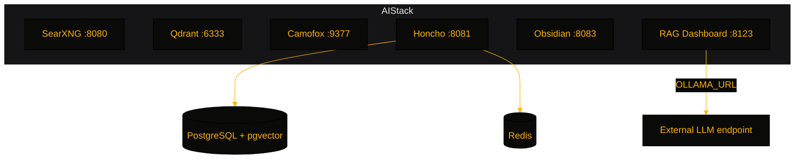

# AIStack

> A unified self-hosted AI infrastructure stack — private search, vector storage, agent memory, browser automation, and a RAG dashboard behind one `docker compose up`.

[](https://github.com/OneByJorah/AIStack)
[](https://github.com/OneByJorah/AIStack)
[](https://github.com/OneByJorah/AIStack/stargazers)
[](https://github.com/OneByJorah/AIStack/commits)
[](https://github.com/OneByJorah/AIStack/actions)


## What This Is

AIStack is a production-ready baseline for running AI agents locally: private metasearch, a vector database, agent memory, a browser agent, a notes vault, and a document-Q&A dashboard, all CPU-only. It exists so you can stand up a complete agent backend on a VPS or homelab without stitching together five separate projects or shipping data to third-party APIs.

## Quick Start

```bash
git clone https://github.com/OneByJorah/AIStack.git
cd AIStack
cp .env.example .env
docker compose up -d
```

Open **http://localhost:8123** for the RAG Dashboard, or **http://localhost:8080** for SearXNG. `install.sh` / `install.ps1` run the same steps with a Docker preflight check.

## Features

- **One-command deploy** — `docker compose up -d` starts the full stack with healthchecks on every service.
- **Private web search** — SearXNG aggregates 100+ providers with no tracking (`:8080`).
- **Vector storage** — Qdrant for embeddings and semantic retrieval (`:6333`, dashboard UI included).
- **Agent memory** — Honcho on PostgreSQL + pgvector + Redis for persistent, namespaced context (`:8081`).
- **Stealth browser** — Camofox provides Playwright-based browser automation (`:9377`).
- **RAG Dashboard** — FastAPI + ChromaDB document Q&A against any OpenAI-compatible endpoint (`:8123`).
- **Notes vault** — Obsidian served in the browser (`:8083`).
- **CPU-only** — runs entirely without a GPU.

> [!NOTE]
> Ollama is not shipped in the compose file. Point the RAG Dashboard at any Ollama/OpenAI-compatible endpoint with `OLLAMA_URL` (defaults to `http://host.docker.internal:11434`). GPU services (llama-server, LiteLLM, Open WebUI, Caddy gateway) have configs in the repo but are not yet wired into `docker-compose.yml`.

## Architecture



## Stack

Docker Compose · SearXNG · Qdrant · Camofox (Playwright) · Honcho + PostgreSQL (pgvector) + Redis · FastAPI · ChromaDB · Sentence Transformers

## Configuration

Set `HONCHO_DB_PASSWORD`, `SEARXNG_SECRET_KEY`, and `RAG_ADMIN_PASSWORD` in `.env` before first run. All published ports bind `0.0.0.0`; Qdrant, Obsidian, and SearXNG have no built-in auth — prefer `127.0.0.1:` binds or an authenticated proxy in production. See [`.env.example`](.env.example) for the full list.

## Contributing

See [CONTRIBUTING.md](CONTRIBUTING.md) and [CODE_OF_CONDUCT.md](CODE_OF_CONDUCT.md), then [open an issue](https://github.com/OneByJorah/AIStack/issues) or a pull request.

## License

MIT — see [LICENSE](LICENSE).
