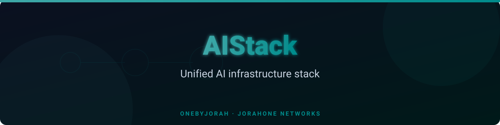
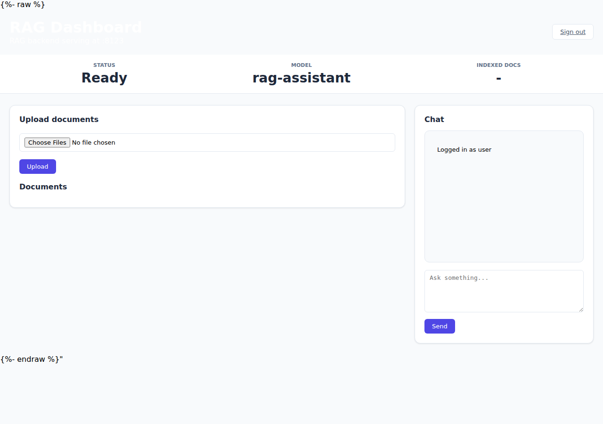
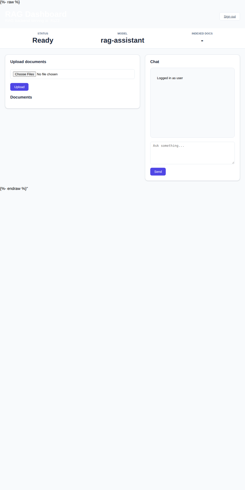
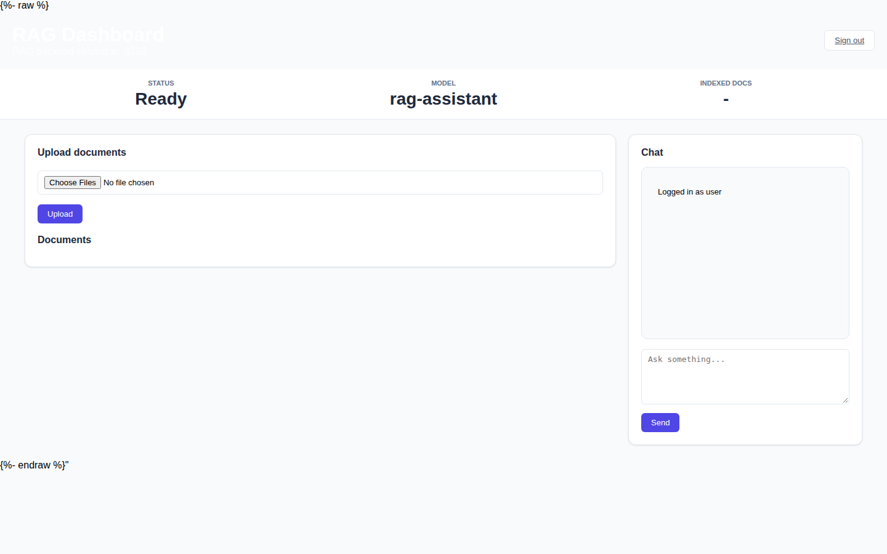

<div align="center">



# AIStack

**Unified self-hosted AI infrastructure stack** — LLM routing, private search, vector storage, agent memory, and browser automation behind one `docker compose up`.

<a href="https://github.com/OneByJorah/AIStack/stargazers"></a>
<a href="https://github.com/OneByJorah/AIStack/commits"></a>


</div>

## Quick Start

```bash
git clone https://github.com/OneByJorah/AIStack.git
cd AIStack
cp .env.example .env
docker compose up -d
```

Open **http://localhost:8123** for the RAG Dashboard, or **http://localhost:8080** for SearXNG. `install.sh` / `install.ps1` run the same steps with a Docker preflight check.

## What This Is

AIStack is a production-ready baseline for running AI agents locally: private metasearch, a vector database, agent memory, a browser agent, a notes vault, and a document-Q&A dashboard, all CPU-only. It exists so you can stand up a complete agent backend on a VPS or homelab without stitching together five separate projects or shipping data to third-party APIs.

## Features

- **One-command deploy** — `docker compose up -d` starts the full stack.
- **Private web search** — SearXNG aggregates 100+ providers with no tracking.
- **Vector storage** — Qdrant for embeddings and semantic search (ANN indexing).
- **Agent memory** — Honcho (PostgreSQL + pgvector + Redis) for persistent context.
- **Stealth browser** — Camofox provides Playwright-based browser automation at `:9377`.
- **RAG Dashboard** — FastAPI + ChromaDB document Q&A against any OpenAI-compatible LLM endpoint.
- **Notes vault** — Obsidian served from the browser at `:8083`.
- **CPU-only** — runs entirely without a GPU; health checks and restart policies included.

> [!NOTE]
> Ollama is **not** shipped in the compose file. Point the RAG Dashboard at any Ollama/OpenAI-compatible endpoint with `OLLAMA_URL` (defaults to `http://host.docker.internal:11434`).

## Services

| Service | Port | Purpose |
|---------|------|---------|
| **SearXNG** | `8080` | Private metasearch (100+ providers) |
| **Qdrant** | `6333` | Vector database (`/dashboard` UI) |
| **Camofox** | `9377` | Stealth browser automation API |
| **Honcho API** | `8081` | Long-term agent memory |
| **Obsidian** | `8083` | Browser-based note vault |
| **RAG Dashboard** | `8123` | Retrieval-augmented document Q&A |
| **Honcho DB** | internal | PostgreSQL + pgvector |
| **Honcho Redis** | internal | Cache layer |

## Architecture

```
┌──────────────────────────────────────────────────────────┐
│                       AIStack                            │
│                                                          │
│  ┌───────────┐  ┌───────────┐  ┌───────────┐            │
│  │  SearXNG  │  │  Qdrant   │  │  Camofox  │            │
│  │  :8080    │  │  :6333    │  │  :9377    │            │
│  └─────┬─────┘  └─────┬─────┘  └─────┬─────┘            │
│        │               │               │                  │
│  ┌─────▼─────┐  ┌─────▼─────┐  ┌─────▼─────┐            │
│  │  Honcho   │  │ Obsidian  │  │    RAG    │            │
│  │  :8081    │  │  :8083    │  │ Dashboard │            │
│  └───────────┘  └───────────┘  └───────────┘            │
│                                                          │
│  Optional: Caddy gateway (caddy/Caddyfile, not wired by  │
│  default) · external LLM endpoint via OLLAMA_URL         │
└──────────────────────────────────────────────────────────┘
```

## Configuration

See [`.env.example`](.env.example) for the full list. Key variables:

| Variable | Default | Description |
|----------|---------|-------------|
| `SERVER_IP` | — | Mesh-VPN IP of the host (used by healthchecks) |
| `OBSIDIAN_VAULT_PATH` | `./obsidian-vault` | Host path for the Obsidian vault |
| `HONCHO_TOKEN` | — | Honcho API auth token |
| `HONCHO_DB_PASSWORD` | placeholder — set it | PostgreSQL password for Honcho |
| `SEARXNG_SECRET_KEY` | dev fallback — set it | SearXNG instance secret |
| `CAMOFOX_API_KEY` / `CAMOFOX_ADMIN_KEY` | — | Camofox auth keys |
| `OLLAMA_URL` | `http://host.docker.internal:11434` | LLM endpoint for the RAG Dashboard |
| `RAG_MODEL` | `rag-assistant` | Ollama model for RAG queries |
| `RAG_ADMIN_PASSWORD` | `admin` | RAG Dashboard admin password |

> [!WARNING]
> All published ports bind `0.0.0.0`; Qdrant, Obsidian, and SearXNG have no built-in auth. Prefer `127.0.0.1:` binds or an authenticated proxy in production, and set `RAG_ADMIN_PASSWORD` on first run.

## Use Cases

1. **AI agent backend** — run autonomous agents with local search, memory, and vector storage.
2. **Private RAG** — document Q&A that never leaves your infrastructure.
3. **Development** — test AI features locally before moving to the cloud.
4. **Homelab / education** — learn agent architectures hands-on for free.

## Tech Stack

Docker Compose, SearXNG, Qdrant, Camofox (Playwright), Honcho + PostgreSQL (pgvector) + Redis, FastAPI, ChromaDB, Sentence Transformers, Caddy (optional).

## Screenshots

| View | Preview |
|------|---------|
| RAG Dashboard |  |
| Full dashboard |  |
| Mobile |  |
| Main viewport |  |

## Project Structure

```
AIStack/
├── docker-compose.yml     # Main orchestration
├── .env.example           # Environment template
├── searxng/               # SearXNG configuration
├── rag-dashboard/         # RAG web application (FastAPI)
├── browser-search/        # Camofox/CloakBrowser skill + scripts
├── caddy/Caddyfile        # Optional reverse proxy (not wired by default)
├── litellm/config.yaml    # Optional LLM routing config (not wired by default)
├── scripts/               # bootstrap, healthcheck, init scripts
├── docs/                  # Documentation + assets
└── README.md
```

## Contributing

Contributions are welcome. Please read [CONTRIBUTING.md](CONTRIBUTING.md) and [CODE_OF_CONDUCT.md](CODE_OF_CONDUCT.md), then [open an issue](https://github.com/OneByJorah/AIStack/issues) or a pull request.

## License

MIT — see [LICENSE](LICENSE).

## Connect

- [jorahone.com](https://jorahone.com)
- [GitHub Org](https://github.com/OneByJorah)
- [info@jorahone.com](mailto:info@jorahone.com)
