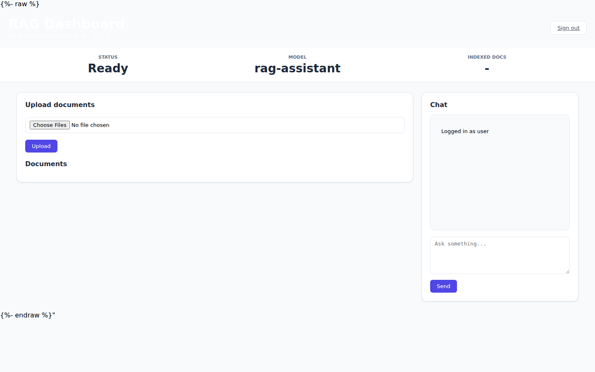

<div align="center">

# AIStack

**Unified AI Infrastructure Stack** — One-command Docker Compose for LLM routing, vector storage, private search, and browser automation.

[](LICENSE)
[](https://docker.com)
[](https://ollama.ai)
[](https://qdrant.tech)
[](https://searxng.org)
[](CONTRIBUTING.md)

</div>

<p align="center">
  
</p>

---

## Overview

AIStack is a production-ready **self-hosted AI infrastructure stack** that brings together the best open-source tools for running AI agents locally. Deploy with a single command — no GPU required.

### What's Included

| Service | Purpose | Port | Status |
|---------|---------|------|--------|
| **Qdrant** | Vector database for semantic search & embeddings | `:6333` | ✅ |
| **SearXNG** | Private metasearch engine (100+ providers, no tracking) | `:8080` | ✅ |
| **Camofox** | Stealth browser automation for web agents | `:9377` | ✅ |
| **Honcho** | Agent memory management (PostgreSQL + Redis) | `:8081` | ✅ |
| **Obsidian** | Browser-based note vault for agents & humans | `:8083` | ✅ |
| **RAG Dashboard** | Document Q&A with retrieval-augmented generation | `:8123` | ✅ |

> **LLM layer:** Ollama is *not* shipped in the compose file. Point the RAG
> Dashboard at any Ollama endpoint via `OLLAMA_URL` (defaults to the host's
> `:11434`).

## Quick Start

```bash
git clone https://github.com/OneByJorah/AIStack.git
cd AIStack
cp .env.example .env
docker compose up -d
```

### Access Services

| Service | URL | Credentials |
|---------|-----|-------------|
| Qdrant Dashboard | `http://localhost:6333/dashboard` | — |
| SearXNG | `http://localhost:8080` | — |
| Camofox API | `http://localhost:9377` | `CAMOFOX_API_KEY` (if set) |
| Honcho API | `http://localhost:8081` | `HONCHO_TOKEN` (if set) |
| Obsidian | `http://localhost:8083` | — |
| RAG Dashboard | `http://localhost:8123` | `admin / admin` (change via `RAG_ADMIN_PASSWORD`) |

## Features

- **One-Command Deploy** — `docker compose up -d` and you're ready
- **LLM Flexibility** — Point services at any Ollama/OpenAI-compatible endpoint via env vars
- **Vector Storage** — Qdrant for embeddings and semantic search (ANN indexing)
- **Private Web Search** — SearXNG aggregates 100+ search providers without tracking
- **Browser Automation** — Camofox stealth browser for undetectable web interaction
- **Agent Memory** — Honcho provides persistent context for AI agents
- **Notes Vault** — Obsidian accessible from the browser at `:8083`
- **CPU-Only** — Runs entirely without GPU, works on any hardware
- **Production Ready** — Health checks, monitoring, and structured logging

## Architecture

```
┌──────────────────────────────────────────────────────────┐
│                       AIStack                            │
│                                                          │
│  ┌───────────┐  ┌───────────┐  ┌───────────┐            │
│  │  SearXNG  │  │  Qdrant   │  │  Camofox  │            │
│  │  :8080    │  │  :6333    │  │  :9377    │            │
│  └─────┬─────┘  └─────┬─────┘  └─────┬─────┘            │
│        │               │               │                  │
│  ┌─────▼─────┐  ┌─────▼─────┐  ┌─────▼─────┐            │
│  │  Honcho   │  │ Obsidian  │  │    RAG    │            │
│  │  :8081    │  │  :8083    │  │ Dashboard │            │
│  └───────────┘  └───────────┘  └───────────┘            │
│                                                          │
│  Optional: Caddy gateway (caddy/Caddyfile, not wired by  │
│  default) · external LLM endpoint via OLLAMA_URL         │
└──────────────────────────────────────────────────────────┘
```

## Tech Stack

| Category | Technology |
|----------|-----------|
| **Orchestration** | Docker Compose |
| **LLM** | Ollama (llama.cpp) |
| **Vector DB** | Qdrant |
| **Search** | SearXNG |
| **Browser** | Camofox (Playwright-based) |
| **Memory** | Honcho + PostgreSQL (pgvector) + Redis |
| **Dashboard** | FastAPI + ChromaDB + Sentence Transformers |

## Configuration

See [`.env.example`](.env.example) for all configuration options.

| Variable | Default | Description |
|----------|---------|-------------|
| `SERVER_IP` | — | Mesh-VPN IP of the host (used by healthcheck) |
| `OBSIDIAN_VAULT_PATH` | `./obsidian-vault` | Host path for the Obsidian vault |
| `HONCHO_TOKEN` | — | Honcho API auth token |
| `HONCHO_DB_PASSWORD` | placeholder — set it! | PostgreSQL password for Honcho |
| `SEARXNG_SECRET_KEY` | dev fallback — set it! | SearXNG instance secret |
| `CAMOFOX_API_KEY` / `CAMOFOX_ADMIN_KEY` | — | Camofox auth keys |
| `OLLAMA_URL` | `http://host.docker.internal:11434` | LLM endpoint for RAG Dashboard |
| `RAG_MODEL` | `rag-assistant` | Ollama model for RAG queries |
| `RAG_ADMIN_PASSWORD` | `admin` | RAG Dashboard admin password |

## Screenshots

<details>
<summary><b>Click to expand</b></summary>

<br>

| Stack Dashboard |
|:---:|
|  |

</details>

## Project Structure

```
AIStack/
├── docker-compose.yml     # Main orchestration
├── .env.example           # Environment template
├── searxng/
│   └── settings.yml       # SearXNG configuration
├── rag-dashboard/         # RAG web application
│   ├── app.py             # FastAPI backend
│   └── Dockerfile
├── browser-search/        # Camofox/CloakBrowser skill + scripts
├── caddy/Caddyfile        # Optional reverse proxy (not wired by default)
├── litellm/config.yaml    # Optional LLM routing config (not wired by default)
├── scripts/               # Utility scripts
│   ├── bootstrap.sh       # Initial setup
│   ├── healthcheck.sh     # Service health checks
│   ├── init-honcho.sh     # Honcho initialization
│   └── init-obsidian.sh   # Vault initialization
├── docs/                  # Documentation
└── README.md
```

## Use Cases

- **AI Agent Backend** — Run autonomous agents with local LLMs, search, and memory
- **Private RAG** — Document Q&A without sending data to third parties
- **Development** — Test AI features locally before cloud deployment
- **Homelab** — Self-hosted AI infrastructure for your home server
- **Education** — Learn about AI agent architectures hands-on

## Contributing

Contributions are welcome! See [CONTRIBUTING.md](CONTRIBUTING.md) and [CODE_OF_CONDUCT.md](CODE_OF_CONDUCT.md).

## Security

Report vulnerabilities to **info@jorahone.com** — see [SECURITY.md](SECURITY.md).

**Known exposure notes** (by design for mesh-VPN/LAN use — do not expose to the public internet):

- All published ports bind `0.0.0.0`; Qdrant (`:6333`), Obsidian (`:8083`) and SearXNG (`:8080`) have no built-in auth.
- Honcho ships with `AUTH_USE_AUTH: "false"`; set a `HONCHO_TOKEN` and enable auth before any shared-network deployment.
- The RAG Dashboard defaults to `admin / admin`; set `RAG_ADMIN_PASSWORD` on first run.
- Prefer binding ports to `127.0.0.1:` or fronting them with an authenticated proxy in production.

## License

[MIT](LICENSE) © Jhonattan L. Jimenez (OneByJorah)

---

<p align="center">
  <a href="https://github.com/OneByJorah">OneByJorah</a>
  ·
  <a href="https://jorahone.com">jorahone.com</a>
  ·
  <a href="docs/HERMES_SETUP.md">Hermes Setup</a>
  ·
  <a href="CHANGELOG.md">Changelog</a>
</p>
